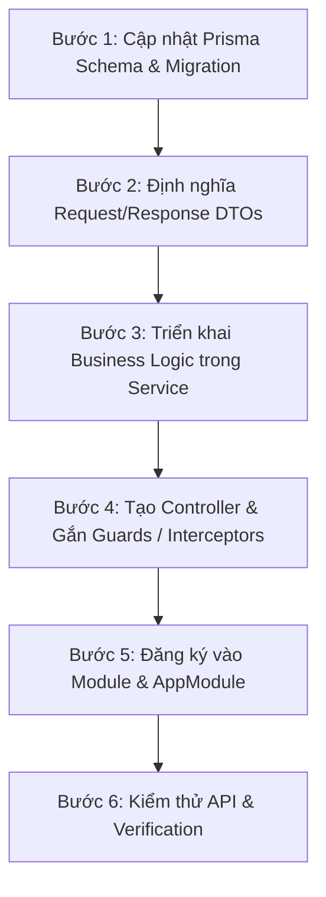

# Backend Development Workflow & Lifecycle

Tài liệu này hướng dẫn quy trình tiêu chuẩn từng bước để xây dựng một tính năng mới (Module/API) hoặc sửa chữa mã nguồn trong hệ thống Backend NestJS.

---

## 1. Quy trình phát triển một Feature mới

Khi tạo mới một tính năng hoặc nghiệp vụ trong Backend, hãy tuân theo 6 bước chuẩn hóa sau:

---

### Bước 1: Cập nhật Prisma Schema & Chạy Migration
1. Mở file domain tương ứng trong `prisma/schema/*.prisma` (hoặc tạo file mới nếu là domain mới).
2. Định nghĩa Model, UUID primary key, relations, `@@map` và `@@index`.
3. Chạy lệnh sinh Prisma client hoặc migration: `npx prisma generate` / `npx prisma migrate dev`.

---

### Bước 2: Định nghĩa DTOs (Data Transfer Objects)
1. Tạo thư mục `src/modules/<tên-module>/dtos/`.
2. Khai báo các DTO đầu vào: `create-<feature>.dto.ts`, `update-<feature>.dto.ts`, `query-<feature>.dto.ts`.
3. Gắn đầy đủ annotation validation từ `class-validator` (`@IsNotEmpty`, `@IsString`, `@IsNumber`, `@IsOptional`, v.v.) và `class-transformer` (`@Type`).

---

### Bước 3: Triển khai Business Logic trong Service
1. Tạo file `<tên-module>.service.ts` với decorator `@Injectable()`.
2. Inject `PrismaService`, `RedisService` qua constructor.
3. Viết các method nghiệp vụ:
   - Validate logic nghiệp vụ (kiểm tra bàn trống, khung giờ hoạt động, quyền chi nhánh).
   - Ném Exception chuẩn (`NotFoundException`, `BadRequestException`) nếu vi phạm.
   - Sử dụng `this.prisma.$transaction` nếu ghi từ 2 bảng trở lên.
   - Trả về dữ liệu sạch cho Controller.

---

### Bước 4: Tạo Controller & Gắn Guards
1. Tạo file `<tên-module>.controller.ts` với `@Controller('<tên-module>')`.
2. Gắn Guards phân quyền: `@UseGuards(JwtAuthGuard, RolesGuard)` và `@Roles(...)`.
3. Định nghĩa các endpoints: `@Get()`, `@Post()`, `@Put()`, `@Delete()`, `@Patch()`.
4. Parse params qua `@Body()`, `@Param()`, `@Query()`, `@CurrentUser()`.

---

### Bước 5: Đăng ký Module & Tích hợp AppModule
1. Tạo file `<tên-module>.module.ts`:
   - Khai báo `controllers: [<Feature>Controller]`.
   - Khai báo `providers: [<Feature>Service]`.
   - Export `<Feature>Service` nếu các module khác cần sử dụng.
2. Import module mới vào `src/app.module.ts`.

---

### Bước 6: Kiểm thử & Xác minh (Testing)
1. Khởi chạy server: `npm run start:dev`.
2. Kiểm tra API bằng Postman/cURL hoặc tích hợp với Frontend.
3. Kiểm tra các kịch bản:
   - Happy Path (200 / 201).
   - Validation Error (400 Bad Request với format chuẩn).
   - Unauthorized / Forbidden (401 / 403).
   - Not Found (404).

---

## 2. Quy trình Fix Bug & Debugging

Khi điều tra và sửa lỗi Backend, Agent/Dev thực hiện truy vết theo thứ tự:

1. **Trace Controller & DTO:** Kiểm tra xem request gửi lên có bị `ValidationPipe` chặn không, decorator nhận đúng body/query/params chưa.
2. **Trace Guard & Auth:** Kiểm tra JWT token có hợp lệ không, vai trò (`Role`) có đủ quyền truy cập endpoint không.
3. **Trace Service:** Kiểm tra logic nghiệp vụ, điều kiện rẽ nhánh `if/else`, giá trị trả về hoặc exception bị throw.
4. **Trace Database Query & Prisma:** Kiểm tra câu lệnh Prisma, quan hệ `include` đã nạp đủ chưa, ràng buộc khóa ngoại có bị vi phạm không.
5. **Trace Redis / Queue:** Kiểm tra kết nối Redis, key name, TTL và dữ liệu cache có bị stale không.
